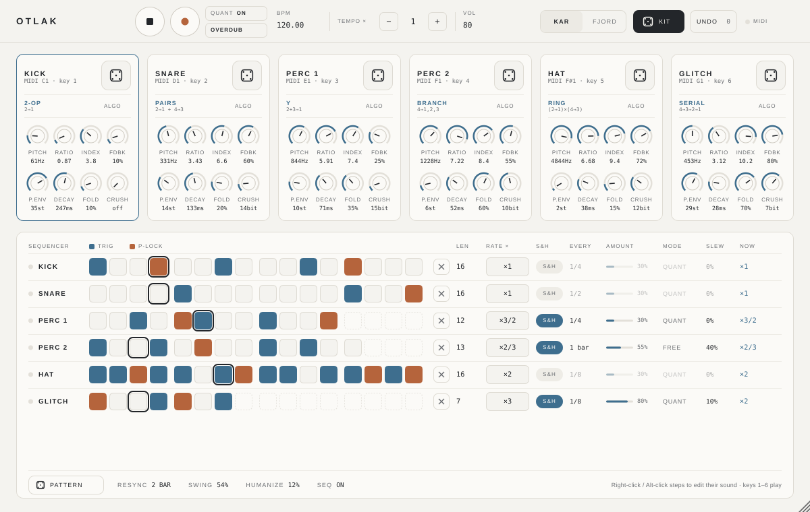
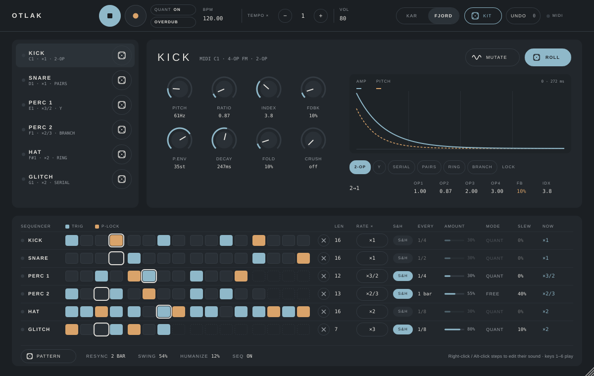

# Otlak — Autechre tarzı FM davul synth'i

Otlak, 6 sesli bir FM davul synth'i. VST3/AU plugin olarak çalışıyor. Kendi poliritmik sequencer'ı var, ama MIDI ile de çalınabiliyor.




## Kurulum (Mac)

1. **Releases** bölümündeki **Son sürüm (otomatik)** sayfasından `Otlak-mac.zip`'i indir. Ya da **Actions** sekmesinde en son yeşil (✓) çalışmayı aç ve `Otlak-mac-…` paketini indir. Zip'i aç.
2. Dosyaları kopyala:
   - `Otlak.vst3` → `~/Library/Audio/Plug-Ins/VST3/`
   - `Otlak.component` → `~/Library/Audio/Plug-Ins/Components/`
3. Plugin imzasız olduğu için macOS ilk açılışta onu engelleyebilir. Terminal'de şu komutu bir kez çalıştır:
   ```
   xattr -dr com.apple.quarantine ~/Library/Audio/Plug-Ins/VST3/Otlak.vst3 ~/Library/Audio/Plug-Ins/Components/Otlak.component
   ```
4. Ableton > Preferences > Plug-Ins bölümünde **Use VST3 Plug-in System Folders** açık olsun, sonra **Rescan**.
5. Bir MIDI track'e **Otlak**'ı instrument olarak yükle.

Paket hem Apple Silicon hem Intel/Rosetta için derleniyor. Live 10 M1'de Rosetta ile çalıştığı için bu önemli.

## Sesler

Altı ses var: KICK, SNARE, PERC 1, PERC 2, HAT, GLITCH. Hepsi aynı 4 operatörlü FM motorunu kullanıyor, her ses kendi algoritmasını seçiyor:

| Algoritma | Yönlendirme | Karakter |
|---|---|---|
| 2-OP | 2→1 | Temiz FM gövde |
| Y | 2+3→1 | İki modülatör, tahta/metal |
| SERIAL | 4→3→2→1 | Zincir, yoğun ve sert |
| PAIRS | 2→1 + 4→3 | Gövde + gürültü katmanı |
| RING | (2→1)×(4→3) | Halka modülasyonu, çınlayan metal |
| BRANCH | 4→1,2,3 | Çan/gong kümesi |

Parametreler: PITCH, RATIO (OP2 oranı), INDEX, FDBK (feedback), P.ENV (pitch zarfı), DECAY, FOLD (wavefolder), CRUSH (bit/sample-rate düşürme). OP3 ve OP4 oranlarını zar seçiyor, Fjord görünümünde hepsi görünüyor. Bütün ses parametreleri Ableton'da otomasyona açık.

- **Zar:** Tık yeni ses, Shift+tık mutasyon (küçük değişiklik). Her ses kendi aralığında kalıyor. **KIT** bütün sesleri zarlıyor.
- **Kilitler:** Parametre adına tıklayınca o parametre zardan korunuyor. **ALGO** / **LOCK** algoritmayı koruyor.
- **UNDO:** Zar, pattern zarı ve temizleme işlemleri geri alınabiliyor.
- **Knob'lar:** Yukarı/aşağı sürükle, Shift ile ince ayar, çift tık başlangıç değeri, fare tekerleği de çalışıyor.

## Sequencer

- **Çalma:** Ableton çalınca sequencer da onunla senkron çalıyor. Ableton dururken ▶ düğmesi sequencer'ı kendi başına çalıştırır. Alt satırdaki **SEQ OFF** sequencer'ı tamamen susturur, Otlak'ı sadece MIDI ile çalmak istersen kullan.
- **Step'ler:** Tık boş → trig → p-lock arasında döner. P-lock step sesin bir varyasyonunu çalar, Shift+tık varyasyonu yeniden zarlar. Kesikli step'e tıklayınca kanal oraya kadar uzar.
- **Step düzenleme:** Step'e **sağ tık** ya da **Alt+tık** ile step'i seçersin (birden fazla seçebilirsin). Seçim varken o sesin knob'ları sadece seçili step'leri değiştirir, kilitli değerler turuncu görünür. Knob'a çift tık o parametrenin kilidini kaldırır. **DONE** ya da Esc seçimi kapatır.
- **×** kanalı temizler, Shift+× bütün kanalları temizler.
- **LEN:** Sürükleyerek 1–16. Aynı sürükleme içinde kısaltıp uzatırsan step'ler geri gelir.
- **RATE ×:** Kanalın tempo çarpanı. Tık artırır, Shift+tık azaltır. Üstteki **TEMPO ×** global çarpan.
- **S&H:** Kanalın temposunu rastgele değiştirir. **EVERY** ne sıklıkla yeni değer seçileceği, **AMOUNT** ne kadar savrulacağı, **QUANT/FREE** değerlerin çarpan listesine kilitlenip kilitlenmeyeceği, **SLEW** değerler arasında kayarak geçiş. **NOW** o anki gerçek çarpanı gösterir.
- **Kanal adı:** Tıklayınca o kanal susar.
- **PATTERN:** Bütün kanallar için rastgele pattern üretir, Shift+tık sadece seçili kanal için.
- **RESYNC:** Kanalları her N barda bir başa hizalar.
- **SWING** ve **HUMANIZE:** Sürüklenerek ayarlanır. HUMANIZE her vuruşta sesi ve zamanlamayı biraz oynatır.

## MIDI ve kayıt

- **Notalar:** C1 KICK, D1 SNARE, E1 PERC 1, F1 PERC 2, F#1 HAT, G1 GLITCH. Velocity hem ses seviyesini hem FM index'ini etkiler. Plugin penceresi seçiliyken bilgisayar klavyesinden 1–6 tuşları da çalar.
- **REC:** Açıkken MIDI notaları (ya da 1–6 tuşları) her kanalın kendi döngüsündeki o anki step'e yazılır. Velocity 110 üstü (ya da Shift+tuş) p-lock step yazar.
- **QUANT:** Açıkken vuruşlar tam step'e oturur. Kapalıyken erken/geç vurduğun da saklanır.
- **OVERDUB / REPLACE:** Overdub ekler. Replace bir kanala ilk vuruşu yaptığında o kanalı temizleyip yeniden yazar.
- **Knob kaydı:** REC açıkken knob çevirirsen hareket o anda çalan step'lere p-lock olarak yazılır.

## Görünüm

Sağ üstteki **KAR / FJORD** iki görünüm arasında geçiş yapar. KAR açık renkli, altı sesin hepsi aynı anda görünür. FJORD koyu renkli, tek sese odaklanır: zarf grafiği, algoritma düğmeleri ve operatör oranları. Seçim bu bilgisayarda hatırlanır. Pencere köşesinden büyütülüp küçültülebilir.

## Geliştirme

```
cmake -B build -DCMAKE_BUILD_TYPE=Release
cmake --build build --target Otlak_VST3 Otlak_AU
ctest --test-dir build            # çekirdek testleri
```

`core/` JUCE'dan bağımsız (FM motoru, sequencer, zar). `plugin/` JUCE plugin'i ve arayüz.
